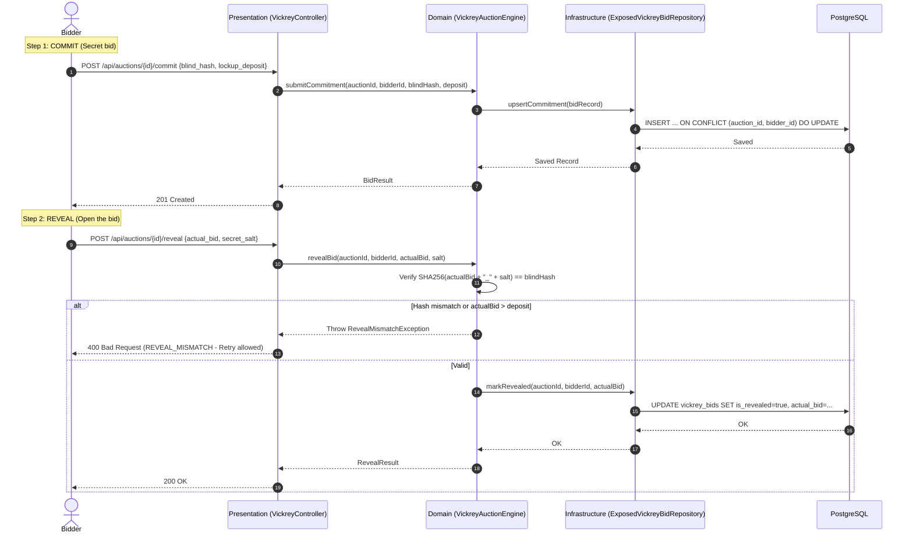
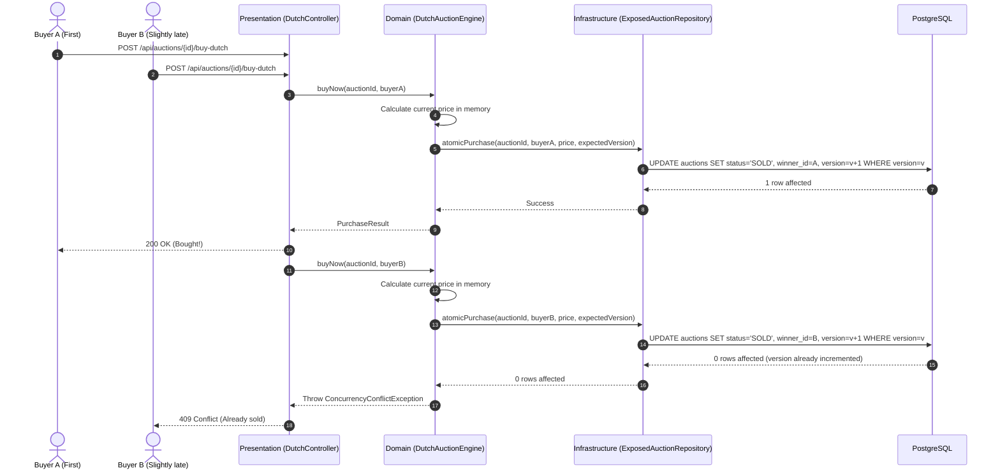

# System Architecture

🌐 **Language**: [English (Current)](ARCHITECTURE.md) | [🇻🇳 Tiếng Việt](ARCHITECTURE.vi.md)

Kronyka is organized into 3 layers following **Clean Architecture** (dependencies point inward):

```
example.kronyka/
├── domain/                  # 1. CORE DOMAIN (Pure Kotlin)
│   ├── model/               #    Entities, value objects, enums, exceptions
│   ├── repository/          #    Repository interfaces (pure Kotlin, no framework code)
│   └── service/             #    Auction engines (Vickrey, Dutch)
├── presentation/            # 2. PRESENTATION (Handles HTTP web requests)
│   ├── controller/          #    REST Controllers
│   ├── dto/                 #    Request/Response DTOs and validation rules
│   └── advice/              #    Global error handlers (@RestControllerAdvice)
└── infrastructure/          # 3. INFRASTRUCTURE (Database & external services)
    ├── persistence/         #    Database tables and queries (Exposed SQL DSL)
    ├── security/            #    JWT authentication filter and Spring Security
    ├── scheduler/           #    Background worker for auction settlement
    └── config/              #    Spring Boot, database, and OpenAPI setup
```

### Dependency Rule
Dependencies flow **strictly inward**: `Presentation -> Domain <- Infrastructure`
- **Domain**: Pure business rules written in Kotlin. Never imports Spring, Exposed, JDBC, or web annotations.
- **Presentation**: Accepts HTTP requests, validates inputs, calls domain services, and returns JSON responses.
- **Infrastructure**: Implements repository interfaces using Exposed SQL DSL, manages database connections, and sets up security.

---

## 1. Sequence Diagrams

### 1.1. Vickrey Sealed-Bid Auction



### 1.2. Dutch Auction ("Buy Now" Race)



---

## 2. Concurrency & Database Rules

1. **Optimistic Locking (`version`)**:
   - The Dutch engine checks `version` when someone clicks buy. If multiple people buy at the exact same time, only the first request updates the row; the others get `409 Conflict`.
2. **Safe Updates for Vickrey Commitments**:
   - `UNIQUE(auction_id, bidder_id)` allows bidders to update their deposit safely without creating duplicate bids or race conditions.
3. **Stateless Price Calculation**:
   - The Dutch price is computed directly from time in memory. There is no background job needed to update prices in the database every second.

---

## 3. Testing Strategy

| Layer | Framework | Style | Assertions | How it runs |
|---|---|---|---|---|
| **Domain** | **Kotest** | `BehaviorSpec`, `FunSpec` | `shouldBe`, `shouldThrow` | Uses in-memory fake repositories. No Spring context or database needed (runs in milliseconds). |
| **Presentation** | **JUnit 5** | `@Test`, `@WebMvcTest` | `shouldBe`, `shouldNotBeNull` | Spring `MockMvc` + MockK to test controllers and validation in isolation. |
| **Infrastructure** | **JUnit 5** | `@Test` | `shouldBe`, `shouldHaveSize` | In-memory database with transaction rollback to verify SQL queries. |
