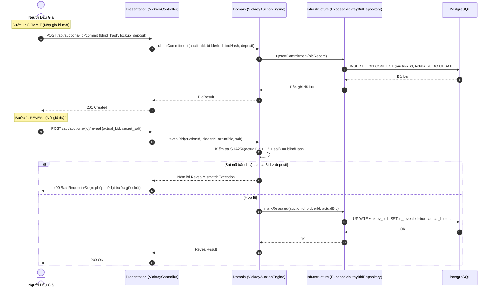
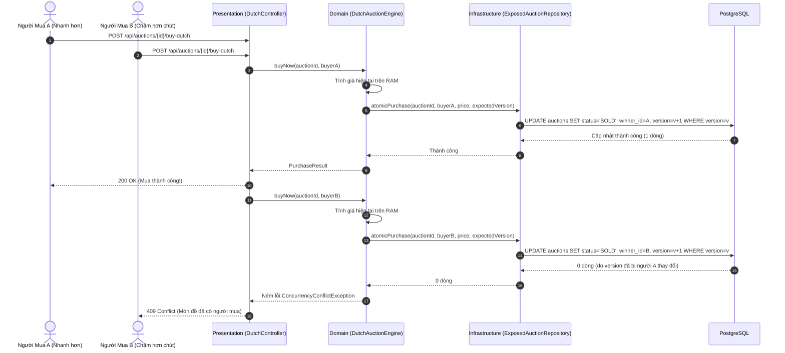

# Kiến Trúc Hệ Thống

🌐 **Ngôn ngữ**: [🇻🇳 Tiếng Việt (Hiện tại)](ARCHITECTURE.vi.md) | [English](ARCHITECTURE.md)

Kronyka được chia làm 3 tầng theo mô hình **Clean Architecture** (các tầng phụ thuộc hướng vào trong):

```
example.kronyka/
├── domain/                  # 1. NGHIỆP VỤ CỐT LÕI (Kotlin thuần)
│   ├── model/               #    Thực thể, dữ liệu nghiệp vụ, enum, exception
│   ├── repository/          #    Interface giao tiếp dữ liệu (thuần Kotlin, không dính framework)
│   └── service/             #    Logic xử lý 2 kiểu đấu giá (Vickrey, Dutch)
├── presentation/            # 2. TẦNG GIAO TIẾP (Nhận request web HTTP)
│   ├── controller/          #    REST Controller
│   ├── dto/                 #    Dữ liệu request/response và kiểm tra hợp lệ dữ liệu
│   └── advice/              #    Xử lý lỗi tập trung (@RestControllerAdvice)
└── infrastructure/          # 3. TẦNG HẠ TẦNG (Cơ sở dữ liệu & dịch vụ bên ngoài)
    ├── persistence/         #    Bảng DB và truy vấn (Exposed SQL DSL)
    ├── security/            #    Xác thực đăng nhập JWT và Spring Security
    ├── scheduler/           #    Tiến trình chạy nền chốt kết quả đấu giá
    └── config/              #    Cấu hình Spring Boot, DB và OpenAPI
```

### Quy tắc phụ thuộc
Mọi phụ thuộc **hướng vào trong**: `Presentation -> Domain <- Infrastructure`
- **Domain**: Chứa logic nghiệp vụ bằng Kotlin thuần túy. Tuyệt đối không import Spring, Exposed, JDBC hay annotation web.
- **Presentation**: Nhận request HTTP, validate dữ liệu đầu vào, gọi xuống domain và trả về kết quả JSON.
- **Infrastructure**: Hiện thực các interface repository bằng Exposed SQL DSL, quản lý kết nối database và cài đặt bảo mật.

---

## 1. Sơ Đồ Luồng Hoạt Động (Sequence Diagrams)

### 1.1. Đấu Giá Kín Vickrey



### 1.2. Đấu Giá Hà Lan (Cuộc Đua "Mua Ngay")



---

## 2. Quy Tắc Xử Lý Dữ Liệu & Đồng Thời

1. **Khóa Lạc Quan (`version`)**:
   - Đấu giá Hà Lan kiểm tra cột `version` khi mua. Nếu nhiều người cùng bấm mua trong một tích tắc, chỉ người gửi lệnh đến trước sửa được dữ liệu, các lệnh sau lập tức nhận lỗi `409 Conflict`.
2. **Cập Nhật An Toàn Tiền Cọc Vickrey**:
   - Ràng buộc duy nhất `UNIQUE(auction_id, bidder_id)` cho phép người tham gia cập nhật tiền cọc nhiều lần mà không sợ bị trùng bản ghi hay lỗi tranh chấp.
3. **Tính Giá Không Cần Chạy Job Nền**:
   - Giá đấu giá Hà Lan được tính trực tiếp từ giờ hệ thống trên RAM. Không cần job chạy nền quét DB mỗi giây để giảm giá.

---

## 3. Chiến Lược Viết Test

| Tầng | Thư viện test | Phong cách | Assertion | Cách chạy |
|---|---|---|---|---|
| **Domain** | **Kotest** | `BehaviorSpec`, `FunSpec` | `shouldBe`, `shouldThrow` | Dùng fake repository trong RAM. Không cần khởi động Spring hay DB (chạy trong vài mili giây). |
| **Presentation** | **JUnit 5** | `@Test`, `@WebMvcTest` | `shouldBe`, `shouldNotBeNull` | Dùng Spring `MockMvc` + MockK để test controller và validate dữ liệu độc lập. |
| **Infrastructure** | **JUnit 5** | `@Test` | `shouldBe`, `shouldHaveSize` | Dùng DB trong RAM kèm rollback transaction để kiểm tra câu lệnh SQL thực tế. |
