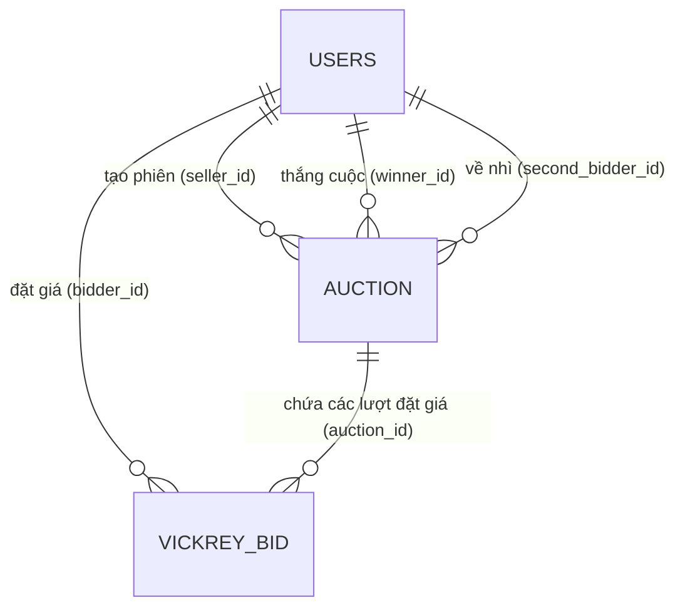

# Lược Đồ Cơ Sở Dữ Liệu & Từ Điển Dữ Liệu

🌐 **Ngôn ngữ**: [🇻🇳 Tiếng Việt (Hiện tại)](DATABASE_SCHEMA.vi.md) | [English](DATABASE_SCHEMA.md)

Kronyka sử dụng **PostgreSQL 18** (Docker image `postgres:18-alpine`). Mọi trường giá tiền đều lưu bằng đơn vị Đồng (VNĐ) với kiểu số nguyên `BIGINT` để tránh sai số dấu phẩy động.

---

## 1. Sơ Đồ Quan Hệ Thực Thể (ERD)

---

## 2. Chi Tiết Các Bảng

### 2.1. Bảng `users` (Người dùng)
| Cột | Kiểu dữ liệu | Nullable | Mặc định | Mô tả |
| :--- | :--- | :--- | :--- | :--- |
| `id` | `UUID` | Không | `gen_random_uuid()` | Khóa chính |
| `username` | `VARCHAR(50)` | Không | | Tên đăng nhập (duy nhất) |
| `password_hash`| `VARCHAR(100)` | Không | | Mã băm mật khẩu BCrypt |
| `full_name` | `VARCHAR(100)` | Không | | Họ và tên hiển thị |
| `created_at` | `TIMESTAMP` | Không | `CURRENT_TIMESTAMP` | Thời điểm tạo tài khoản |

### 2.2. Bảng `auction` (Phiên đấu giá)
| Cột | Kiểu dữ liệu | Nullable | Mặc định | Mô tả |
| :--- | :--- | :--- | :--- | :--- |
| `id` | `UUID` | Không | `gen_random_uuid()` | Khóa chính |
| `seller_id` | `UUID` | Không | | Khóa ngoại trỏ tới `users(id)` |
| `title` | `VARCHAR(255)` | Không | | Tên sản phẩm / tiêu đề phiên |
| `type` | `VARCHAR(20)` | Không | | Kiểu đấu giá: `VICKREY` hoặc `DUTCH` |
| `status` | `VARCHAR(20)` | Không | | Trạng thái: `COMMIT`, `REVEAL`, `ACTIVE`, `SOLD`, `SETTLED`, `CANCELLED` |
| `start_price` | `BIGINT` | Có | | Giá khởi điểm trần (đấu giá Hà Lan) |
| `floor_price` | `BIGINT` | Có | | Giá sàn tối thiểu (đấu giá Hà Lan) |
| `step_decrement`| `BIGINT` | Có | | Mức giảm mỗi nấc (đấu giá Hà Lan) |
| `step_interval_seconds` | `INT` | Có | | Thời gian mỗi nấc tính bằng giây (đấu giá Hà Lan) |
| `reserve_price`| `BIGINT` | Có | | Giá sàn khởi điểm (đấu giá Vickrey) |
| `start_time` | `TIMESTAMP` | Không | | Thời gian bắt đầu phiên |
| `commit_end_time` | `TIMESTAMP`| Có | | Hạn chót nộp giá bí mật (Vickrey) |
| `reveal_end_time` | `TIMESTAMP`| Có | | Hạn chót mở giá thật (Vickrey) |
| `end_time` | `TIMESTAMP` | Không | | Thời gian kết thúc phiên đấu giá |
| `winner_id` | `UUID` | Có | | Khóa ngoại `users(id)` (Người thắng) |
| `second_bidder_id` | `UUID` | Có | | Khóa ngoại `users(id)` (Người về nhì Vickrey) |
| `final_price` | `BIGINT` | Có | | Giá chốt giao dịch cuối cùng |
| `version` | `BIGINT` | Không | `0` | Biến đếm khóa lạc quan (đấu giá Hà Lan) |
| `created_at` | `TIMESTAMP` | Không | `CURRENT_TIMESTAMP` | Thời điểm tạo bản ghi |

### 2.3. Bảng `vickrey_bid` (Lượt đấu giá kín)
| Cột | Kiểu dữ liệu | Nullable | Mặc định | Mô tả |
| :--- | :--- | :--- | :--- | :--- |
| `id` | `UUID` | Không | `gen_random_uuid()` | Khóa chính |
| `auction_id` | `UUID` | Không | | Khóa ngoại trỏ tới `auction(id)` (Xóa bị chặn RESTRICT) |
| `bidder_id` | `UUID` | Không | | Khóa ngoại trỏ tới `users(id)` |
| `blind_hash` | `VARCHAR(64)` | Không | | Mã băm SHA-256 giấu giá |
| `lockup_deposit`| `BIGINT` | Không | | Tiền ký quỹ công khai |
| `actual_bid` | `BIGINT` | Có | | Giá thật sau khi mở |
| `is_revealed` | `BOOLEAN` | Không | `FALSE` | Trạng thái đã mở giá hay chưa |
| `created_at` | `TIMESTAMP` | Không | `CURRENT_TIMESTAMP` | Thời điểm nộp giá bí mật |
| `revealed_at` | `TIMESTAMP` | Có | | Thời điểm mở giá thật |

---

## 3. Ràng Buộc & Chỉ Mục (Indexes)

1. **Ràng buộc duy nhất**: `UNIQUE(auction_id, bidder_id)` trên bảng `vickrey_bid` để đảm bảo mỗi người chỉ có 1 lượt cọc trong phiên, và cập nhật cọc dễ dàng không sợ tranh chấp.
2. **Khóa lạc quan**: Cột `version` trên bảng `auction` tự động tăng 1 mỗi khi thay đổi trạng thái bán.
3. **Chỉ mục tìm kiếm (Indexes)**:
   - `idx_auction_type_status` trên `auction(type, status)` để lọc danh sách nhanh.
   - `idx_vickrey_bid_settle` trên `vickrey_bid(auction_id, is_revealed, actual_bid DESC)` để chốt người thắng và người về nhì tức thì.
