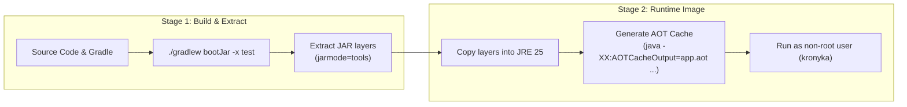

# Deployment & Build Guide

🌐 **Language**: [English (Current)](DEPLOYMENT.md) | [🇻🇳 Tiếng Việt](DEPLOYMENT.vi.md)

This document explains how to build, run, and configure **Kronyka** using Docker/Podman or directly on your machine.

---

## 1. How the Docker Build Works

The project uses a two-stage `Containerfile` based on **Eclipse Temurin 25** and **Spring Boot 4.1**.

### 1.1. Build Stages



1. **Stage 1 (Builder)**:
   - Uses `eclipse-temurin:25-jdk-alpine`.
   - Copies Gradle wrapper and dependencies first (so Docker caches them if code didn't change).
   - Builds the runnable JAR and extracts it into separate layers (`dependencies`, `spring-boot-loader`, `application`).

2. **Stage 2 (Runner)**:
   - Uses lightweight `eclipse-temurin:25-jre-alpine`.
   - Runs as an unprivileged user `kronyka` for security.
   - **Java 25 AOT Cache**: Runs a quick training step during the image build:
     ```dockerfile
     RUN java -XX:AOTCacheOutput=app.aot \
         -Dspring.context.exit=onRefresh \
         -Dspring.datasource.url=jdbc:h2:mem:aotdb \
         -Dspring.datasource.driver-class-name=org.h2.Driver \
         -jar application.jar
     ```
     This pre-caches class metadata and Spring context reflection, so the JVM doesn't have to load and verify all classes from scratch when the container boots.

---

## 2. Running with Docker Compose (`compose.yaml`)

The setup includes 2 services:
- **`postgres`**: PostgreSQL 18 Alpine database with data stored in a Docker volume (`pgdata`).
- **`app`**: The Spring Boot backend running on port `8080`. It waits until PostgreSQL is healthy before starting.

### Common Commands:
```bash
# Build and start everything in the background
docker compose up --build -d

# View live application logs
docker compose logs -f app

# Check status of containers
docker compose ps

# Stop containers (keeps database data)
docker compose down

# Stop containers and reset database completely
docker compose down -v
```

---

## 3. Environment Variables

These variables are defined in `.env.example` and can be customized in `compose.yaml`:

| Variable | Default Value | Description |
|---|---|---|
| `SERVER_PORT` | `8080` | Port the app listens on |
| `POSTGRES_DB` | `kronyka` | Database name |
| `POSTGRES_USER` | `kronyka` | Database username |
| `POSTGRES_PASSWORD` | `kronyka_secret` | Database password |
| `SPRING_DATASOURCE_URL` | `jdbc:postgresql://postgres:5432/kronyka` | Database JDBC URL |
| `JWT_SECRET` | *(Default 32-char key)* | Secret key used to sign JWT tokens (change in production) |
| `JWT_EXPIRATION` | `86400` | Token expiration time in seconds (default: 24 hours) |
| `KRONYKA_AUCTION_SETTLEMENT_ENABLED` | `true` | Turn the background settlement worker on or off |
| `KRONYKA_AUCTION_SETTLEMENT_FIXED_DELAY_MS` | `5000` | How often the worker checks for ended auctions (ms) |
| `KRONYKA_AUCTION_SETTLEMENT_BATCH_SIZE` | `50` | Maximum number of auctions settled per scan |

---

## 4. Local Development (Without Docker for App)

If you prefer developing directly on your machine:
```bash
# 1. Start only the PostgreSQL database
docker compose up -d postgres

# 2. Run the application (requires JDK 25 installed)
./gradlew bootRun

# 3. Run all tests
./gradlew test
```
