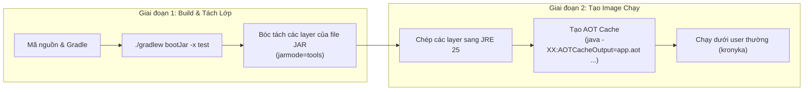

# Hướng Dẫn Kỹ Thuật Deploy & Build Ứng Dụng

🌐 **Ngôn ngữ**: [🇻🇳 Tiếng Việt (Hiện tại)](DEPLOYMENT.vi.md) | [English](DEPLOYMENT.md)

Tài liệu này hướng dẫn cách build, chạy và cấu hình ứng dụng **Kronyka** bằng Docker/Podman hoặc chạy trực tiếp trên máy lập trình.

---

## 1. Cơ Chế Build Docker Của Dự Án

Dự án sử dụng file `Containerfile` chia làm 2 giai đoạn (multi-stage) dựa trên **Eclipse Temurin 25** và **Spring Boot 4.1**.

### 1.1. Các Giai Đoạn Build



1. **Giai đoạn 1 (Builder)**:
   - Dùng image `eclipse-temurin:25-jdk-alpine`.
   - Chép wrapper Gradle và tải trước dependency (Docker sẽ cache lại bước này nếu mã nguồn không đổi thư viện).
   - Đóng gói file JAR và bóc tách thành các thư mục riêng (`dependencies`, `spring-boot-loader`, `application`).

2. **Giai đoạn 2 (Runner)**:
   - Dùng image nhẹ `eclipse-temurin:25-jre-alpine`.
   - Chạy dưới quyền user hệ thống `kronyka` (không chạy quyền root để đảm bảo an toàn).
   - **Tính năng AOT Cache của Java 25**: Chạy một lượt nạp thử trong lúc build image:
     ```dockerfile
     RUN java -XX:AOTCacheOutput=app.aot \
         -Dspring.context.exit=onRefresh \
         -Dspring.datasource.url=jdbc:h2:mem:aotdb \
         -Dspring.datasource.driver-class-name=org.h2.Driver \
         -jar application.jar
     ```
     Lượt chạy này lưu sẵn metadata của các class và proxy Spring, giúp JVM không phải parse và liên kết lại các class từ đầu khi bật container.

---

## 2. Khởi Chạy Bằng Docker Compose (`compose.yaml`)

Bộ cài đặt gồm 2 service:
- **`postgres`**: Cơ sở dữ liệu PostgreSQL 18 Alpine, dữ liệu được giữ lại trong Docker volume (`pgdata`).
- **`app`**: Backend Spring Boot chạy ở cổng `8080`, tự động đợi PostgreSQL sẵn sàng mới khởi động.

### Các Lệnh Thường Dùng:
```bash
# Build và bật toàn bộ hệ thống dưới nền
docker compose up --build -d

# Xem log chạy trực tiếp của app
docker compose logs -f app

# Kiểm tra trạng thái các container
docker compose ps

# Dừng container (vẫn giữ dữ liệu trong DB)
docker compose down

# Dừng container và xóa trắng dữ liệu DB (reset sạch)
docker compose down -v
```

---

## 3. Danh Sách Biến Môi Trường

Các biến này được khai báo mẫu trong `.env.example` và truyền vào qua `compose.yaml`:

| Tên biến | Giá trị mặc định | Giải thích |
|---|---|---|
| `SERVER_PORT` | `8080` | Cổng HTTP mà ứng dụng mở ra |
| `POSTGRES_DB` | `kronyka` | Tên cơ sở dữ liệu |
| `POSTGRES_USER` | `kronyka` | Tên người dùng database |
| `POSTGRES_PASSWORD` | `kronyka_secret` | Mật khẩu database |
| `SPRING_DATASOURCE_URL` | `jdbc:postgresql://postgres:5432/kronyka` | Chuỗi kết nối JDBC tới PostgreSQL |
| `JWT_SECRET` | *(Chuỗi khóa 32 ký tự)* | Khóa bí mật ký token JWT (nhớ đổi khi lên production) |
| `JWT_EXPIRATION` | `86400` | Thời hạn của token JWT tính bằng giây (mặc định 24h) |
| `KRONYKA_AUCTION_SETTLEMENT_ENABLED` | `true` | Bật hoặc tắt tiến trình chạy ngầm chốt đấu giá |
| `KRONYKA_AUCTION_SETTLEMENT_FIXED_DELAY_MS` | `5000` | Chu kỳ quét kiểm tra phiên đấu giá đã kết thúc (mili giây) |
| `KRONYKA_AUCTION_SETTLEMENT_BATCH_SIZE` | `50` | Số lượng phiên tối đa được xử lý trong mỗi lượt quét |

---

## 4. Chạy Khi Lập Trình Trên Máy Cá Nhân (Local)

Nếu bạn muốn chạy code trực tiếp bằng IDE hoặc Gradle:
```bash
# 1. Chỉ bật container database PostgreSQL
docker compose up -d postgres

# 2. Khởi chạy ứng dụng (yêu cầu máy đã cài JDK 25)
./gradlew bootRun

# 3. Chạy toàn bộ test
./gradlew test
```
