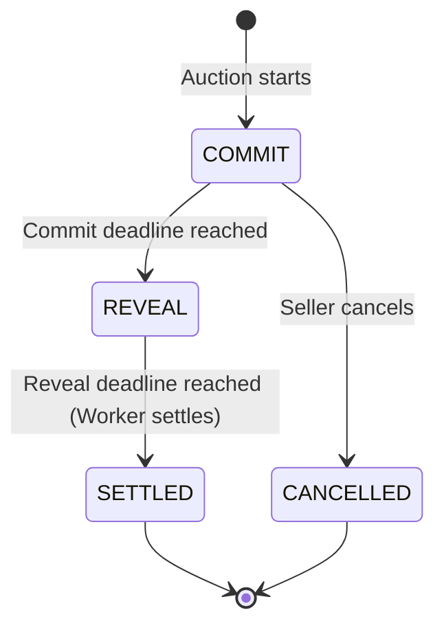

# Auction Engine Details

🌐 **Language**: [English (Current)](DOMAIN_ENGINES.md) | [🇻🇳 Tiếng Việt](DOMAIN_ENGINES.vi.md)

This document explains how the two auction types in Kronyka work under the hood: **Vickrey Auction** (Sealed-Bid) and **Dutch Auction** (Descending Price).

---

## 1. Vickrey Sealed-Bid Auction

### 1.1. How it Works
In an open auction, people often wait until the last second to bid (sniping) or fake bids to drive up the price. 

In a Vickrey auction:
- Everyone places their bid **secretly**.
- When the auction closes, the highest bidder wins, but **only pays the price of the second highest bid** (or the reserve price if there is only 1 bidder).
- Why this rule? Because you only pay the second highest bid, the smartest and safest strategy is simply to bid the maximum amount you are genuinely willing to pay, without worrying about overpaying.



### 1.2. The 3 Steps

#### Step 1: Commit (Secret Bid)
- **Time window**: From start time to commit deadline.
- **What the user does**:
  1. Generates a hash:
     ```
     blind_hash = SHA-256(actual_bid + "_" + secret_salt)
     ```
  2. Picks a deposit where `lockup_deposit >= actual_bid`.
  3. Sends `POST /api/auctions/{id}/commit` with `{ blind_hash, lockup_deposit }`.
- **Database**: Only the hash and deposit are saved. Nobody (not even server admins) can see the actual bid amount. If the user submits again, their commitment updates safely.

#### Step 2: Reveal (Open the Bid)
- **Time window**: From commit deadline to reveal deadline.
- **What the user does**: Sends `POST /api/auctions/{id}/reveal` with `{ actual_bid, secret_salt }`.
- **Server checks**:
  1. `SHA-256(actual_bid + "_" + secret_salt) == blind_hash`
  2. `actual_bid <= lockup_deposit`
- If checks fail: returns `400 Bad Request` (`REVEAL_MISMATCH`). The user can retry with the correct salt and bid before the deadline.
- If checks pass: saves `actual_bid` and marks the bid as revealed.

#### Step 3: Settle (Pick Winner)
- Triggered automatically by a background task after the reveal window closes.
- **Rules**:
  1. Sort all revealed bids from highest to lowest.
  2. Highest bidder wins.
  3. Price to pay:
     - If $\ge 2$ valid bids: price = 2nd highest bid.
     - If 1 valid bid: price = reserve price.
     - If 0 valid bids: auction ends unsold.
- **Refunds**:
  - Winner gets back: `deposit - price to pay`.
  - Everyone else gets back: `100% of deposit`.

---

## 2. Dutch Auction (Descending Price)

### 2.1. How it Works
The price starts high and automatically drops by a fixed amount after each time interval. The first person to accept the current price and click buy wins the item immediately.

### 2.2. Price Formula
The price is calculated directly in memory from the current system clock (no database updates or background jobs needed to drop the price):

```
steps = floor((now - start_time) / step_interval_seconds)
price = max(floor_price, start_price - steps * step_decrement)
```

- `start_price`: Starting price.
- `floor_price`: Minimum price the item can drop to.
- `step_decrement`: How much the price drops each step.
- `step_interval_seconds`: How often the price drops (e.g., every 60 seconds).

### 2.3. Buying ("Buy Now")
When someone calls `POST /api/auctions/{id}/buy-dutch`:
1. Check that the auction is still `ACTIVE` and hasn't expired.
2. Calculate the current price using the formula above.
3. Update the database using optimistic locking (`version` check):
4. If 0 rows were updated, it means another buyer was faster and completed the purchase a split second earlier. The server immediately returns `409 Conflict`.
