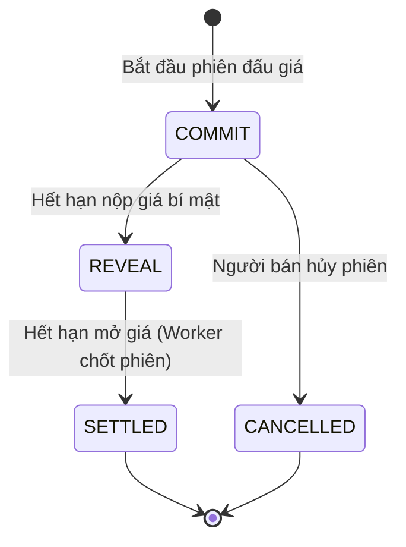

# Chi Tiết Nghiệp Vụ Đấu Giá

🌐 **Ngôn ngữ**: [🇻🇳 Tiếng Việt (Hiện tại)](DOMAIN_ENGINES.vi.md) | [English](DOMAIN_ENGINES.md)

Tài liệu này giải thích cách hoạt động của 2 kiểu đấu giá trong Kronyka: **Đấu Giá Kín (Vickrey)** và **Đấu Giá Giảm Dần (Hà Lan)**.

---

## 1. Đấu Giá Kín (Vickrey)

### 1.1. Cách Hoạt Động
Trong đấu giá thông thường, mọi người thường canh những giây cuối cùng để nhảy vào trả giá (bắn tỉa) hoặc có người cài chim mồi thổi giá.

Đấu giá Vickrey giải quyết việc này bằng cách:
- Mọi người gửi giá thầu hoàn toàn **bí mật**.
- Khi hết giờ, người trả giá cao nhất sẽ thắng, nhưng **chỉ phải trả mức giá của người cao thứ nhì** (hoặc giá sàn nếu chỉ có 1 người đấu giá).
- Vì chỉ phải trả mức giá của người thứ nhì, chiến lược khôn ngoan và an toàn nhất cho người mua là cứ đặt thẳng mức giá tối đa mà mình sẵn sàng chi trả, không cần phải tính toán đoán già đoán non hay sợ bị hớ.



### 1.2. Quy Trình 3 Bước

#### Bước 1: Commit (Nộp giá bí mật)
- **Thời gian**: Từ lúc bắt đầu đến hạn chót nộp giá.
- **Người mua làm gì**:
  1. Tạo mã băm:
     ```
     blind_hash = SHA-256(actual_bid + "_" + secret_salt)
     ```
  2. Chọn số tiền cọc sao cho `lockup_deposit >= actual_bid`.
  3. Gửi API `POST /api/auctions/{id}/commit` kèm `{ blind_hash, lockup_deposit }`.
- **Lưu DB**: Hệ thống chỉ lưu mã băm và tiền cọc. Không một ai (kể cả admin máy chủ) thấy được giá thật. Nếu nộp lại, hệ thống sẽ tự động cập nhật bản ghi an toàn.

#### Bước 2: Reveal (Mở giá thật)
- **Thời gian**: Từ lúc hết hạn nộp đến hạn chót mở giá.
- **Người mua làm gì**: Gửi API `POST /api/auctions/{id}/reveal` kèm `{ actual_bid, secret_salt }`.
- **Hệ thống kiểm tra**:
  1. `SHA-256(actual_bid + "_" + secret_salt) == blind_hash`
  2. `actual_bid <= lockup_deposit`
- Nếu sai: trả về `400 Bad Request` (`REVEAL_MISMATCH`). Người dùng có thể kiểm tra lại salt/giá và gửi lại trước giờ chót.
- Nếu đúng: lưu giá thật `actual_bid` và đánh dấu đã mở giá thành công.

#### Bước 3: Settle (Chốt người thắng)
- Tiến trình chạy nền sẽ tự động quét và chốt sau khi hết hạn mở giá.
- **Quy tắc**:
  1. Xếp các mức giá hợp lệ từ cao xuống thấp.
  2. Người trả giá cao nhất thắng cuộc.
  3. Mức giá phải trả:
     - Nếu có từ 2 người trở lên: giá phải trả = giá của người cao thứ 2.
     - Nếu chỉ có 1 người: giá phải trả = giá sàn (`reserve_price`).
     - Nếu không có ai: phiên kết thúc không có người mua.
- **Hoàn trả tiền cọc**:
  - Người thắng: nhận lại `tiền cọc - giá phải trả`.
  - Những người không trúng: nhận lại `100% tiền cọc`.

---

## 2. Đấu Giá Giảm Dần (Đấu Giá Hà Lan)

### 2.1. Cách Hoạt Động
Giá bắt đầu ở mức cao và tự động giảm dần một khoản tiền cố định sau mỗi khoảng thời gian. Người đầu tiên chấp nhận mức giá hiện tại và bấm mua sẽ sở hữu món đồ ngay lập tức.

### 2.2. Công Thức Tính Giá
Giá được tính trực tiếp trong bộ nhớ RAM dựa theo đồng hồ hệ thống (không cần câu lệnh update DB hay job nền định kỳ để hạ giá):

```
steps = floor((now - start_time) / step_interval_seconds)
price = max(floor_price, start_price - steps * step_decrement)
```

- `start_price`: Giá khởi điểm (trần).
- `floor_price`: Mức giá sàn tối thiểu (không thể giảm thấp hơn).
- `step_decrement`: Số tiền giảm sau mỗi nấc.
- `step_interval_seconds`: Thời gian của mỗi nấc (ví dụ: cứ 60 giây giảm 1 lần).

### 2.3. Thao Tác "Mua Ngay" (Buy Now)
Khi người dùng gọi `POST /api/auctions/{id}/buy-dutch`:
1. Kiểm tra phiên đấu giá vẫn đang `ACTIVE` và chưa hết giờ.
2. Tính mức giá hiện tại theo công thức trên.
3. Cập nhật vào DB kèm kiểm tra khóa lạc quan (cột `version`):
4. Nếu số dòng được cập nhật bằng 0, nghĩa là đã có một người khác bấm mua trước. Hệ thống lập tức trả về lỗi `409 Conflict`.
